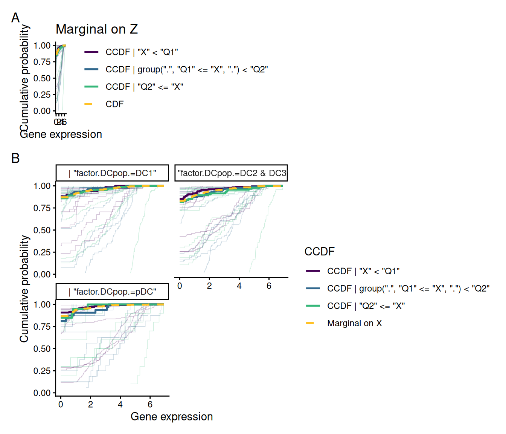

# User guide to the cit_gsa function


## 1 Overview of `citcdf` for gene set analysis

`citcdf` performs **c**onditional **i**ndependence **t**esting through
conditional **c**umulative **d**istribution **f**unctions ([Gauthier et
al. 2021](#ref-gauthier2021)). In the case of gene set analysis it
addresses the following null hypothesis for each gene g of the gene set
of size s: H_0: Y\_{g} \perp\\\\\\\perp X \mid Z, \\\forall g \in \[s\].

by testing whether F\_{Y\_{g} \mid X, Z}(y) = F\_{Y\_{g} \mid Z}(y), \\
\forall g \in \[s\]. The associated test statistic is computed across a
grid of thresholds \omega_1 \< \dots \< \omega_p spanning Y, where the
indicator \mathbb{1}\_{Y_ig \le \omega_j} is regressed on both X and Z
at each threshold j. Under H_0, the coefficients \beta_jg carried by X
are all null, and thus `cit_gsa` test statistic is the sum of squares
whose asymptotic distribution is then a weighted mixture of \chi^2_1.

No distributional assumption is made on Y, and in that sense `cit_gsa`
is *distribution-free*. It is therefore robust to zero-inflation,
multi-modality and skewness that typical occur in single-cell RNA-seq
data.

### 1.1 Function

- `cit_gsa():` many outcomes at once, can test several gene sets, either
  asymptotic or permutation test

### 1.2 Inputs

`Y` is a numeric vector. `X` and `Z` are data frames, one column per
variable, numeric or factor. `geneset` could be either a vector, a list,
a gmt file or a BiocSet object.

``` r

library(citcdf)
set.seed(20260817)
```

## 2 Testing a gene set with `cit_gsa()`

### 2.1 The data

We use a part of the dataset from ([Villani et al.
2017](#ref-villani2017single)). Villani et al.
([2017](#ref-villani2017single)) isolated DCs from Peripheral Blood
Mononuclear Cells (PBMCs) in healthy donor blood, and measured gene
expression through single-cell RNA-seq. They documented DC
sub-populations with their own specific transcriptional signatures. The
dataset originally contain 26,594 genes and 1140 cells but we only keep
here 458 genes and 539 cells. We normalized the data with
log-transformed transcripts per million (log(TPM+1)) as in the original
paper.

To perform gene set analysis we use a part of the gene sets database BTM
of Stanford ([Li et al. 2014](#ref-li2014molecular)). we have 48 gene
set of sizes between 10 and 82.

### 2.2 Objectives

To identify which gene sets are significantly associated with the
expression of the gene CD83, known to be a marker of DC activation. As
CD83 expression varies across DC subset we will incorporate in our
differential analysis an adjustment on the DC subpopulation.

### 2.3 Gene set test

M is the gene expression matrix, X is the CD83 expression, Z is the DC
subpopulation and geneset are the BTM of Stanford gene sets.

**NB**: M must be oriented *cells-by-genes*, the transpose of usual
*genes-by-cells* expression matrix.

``` r

M <- data.frame(t(data_Villani))
X <- data.frame(t(data_Villani[which(rownames(data_Villani) == "CD83"), ]))
Z <- data.frame(DCpop)
geneset <- BTM_geneset$genesets
```

We perform two tests: a marginal test without conditioning on DC
subpopulations, and a second test conditioning on the subpopulations.

``` r

res_unadj <- cit_gsa(M, X, Z = NULL, geneset, test = "asymptotic", parallel = FALSE)
res_adj <-  cit_gsa(M, X, Z, geneset, test = "asymptotic", parallel = FALSE)

c(unadjusted = sum(res_unadj$pvals$adj_pval < 0.05),
  adjusted   = sum(res_adj$pvals$adj_pval < 0.05))
#> unadjusted   adjusted 
#>         25         15
```

Conditionning on DC subpopulation allow to reduce the number of
significant gene sets.

`res_adj` is a list containing:

- `which_test` and `n_perm`, the test performed and the number of
  permutations (`NA` for the asymptotic test)
- `pvals`, the gene set raw and BH-adjusted p-values, plus the test
  statistics

### 2.4 Visualization

[`plot.cit_gsa()`](https://sistm.github.io/citcdf/reference/plot.cit_gsa.md)
details one gene set. **Panel A** show the CCDF for each genes of the
gene sets given CD83 expression with the marginal, i.e. only given DC
subsets . The thick lines are the median value across the genes of the
gene set. **Panel B** show the same comparison but within DC
subpopulations.

**NB** : Z must be a numeric or factor type, not a character.

``` r

i <- which.min(res_adj$pval$adj_pval)

plot(
  x = res_adj ,
  M =  M,
  X =  X,
  Z = data.frame(factor(DCpop)),
  geneset = geneset, 
  which_set = i
)
```



## 3 Practical considerations

**Threshold grid:** `space_y = FALSE` places a threshold at every
distinct value of `Y`, while `space_y = TRUE` uses a regular grid of
`number_y` points instead, at a cost independent of `n`.  
Defaults: `space_y = TRUE` and `number_y = 10`

**Parallelism.**
[`cit_gsa()`](https://sistm.github.io/citcdf/reference/cit_gsa.md)
parallelises over the gene of the gene set and defaults to
`parallel = interactive()`. Calls above set `parallel = FALSE` for
reproducible builds. Drop it in real analyses, and set `n_cpus`.

**Multiplicity.**
[`cit_gsa()`](https://sistm.github.io/citcdf/reference/cit_gsa.md)
returns Benjamini-Hochberg adjusted p-values in `adj_pval` for FDR
control across the gene sets.

**Design.** The asymptotic test accepts several variables of interest
(`ncol(X) > 1`) and several covariates (`ncol(Z) > 1`). The permutation
test is less flexible accepting at most one covariate.

**Preprocessing.** Normalization remains the user’s choice and
responsibility.

## 4 Session information

    ─ Session info ───────────────────────────────────────────────────────────────
     setting  value
     version  R version 4.6.1 (2026-06-24)
     os       Ubuntu 24.04.5 LTS
     system   x86_64, linux-gnu
     ui       X11
     language en-US
     collate  C.UTF-8
     ctype    C.UTF-8
     tz       UTC
     date     2026-10-19
     pandoc   3.8.3 @ /opt/hostedtoolcache/pandoc/3.8.3/x64/ (via rmarkdown)
     quarto   1.10.19 @ /usr/local/bin/quarto

    ─ Packages ───────────────────────────────────────────────────────────────────
     package      * version date (UTC) lib source
     citcdf       * 1.2.1   2026-10-19 [1] local
     cli            3.6.6   2026-04-09 [1] RSPM
     DBI            1.3.0   2026-02-25 [1] RSPM
     digest         0.6.39  2025-11-19 [1] RSPM
     dplyr          1.2.1   2026-04-03 [1] RSPM
     evaluate       1.0.5   2025-08-27 [1] RSPM
     farver         2.1.2   2024-05-13 [1] RSPM
     fastmap        1.2.0   2024-05-15 [1] RSPM
     generics       0.1.4   2025-05-09 [1] RSPM
     ggplot2        4.0.3   2026-04-22 [1] RSPM
     glue           1.8.1   2026-04-17 [1] RSPM
     gtable         0.3.6   2024-10-25 [1] RSPM
     htmltools      0.5.9   2025-12-04 [1] RSPM
     htmlwidgets    1.6.4   2023-12-06 [1] RSPM
     jsonlite       2.0.0   2025-03-27 [1] RSPM
     knitr          1.52    2026-09-06 [1] RSPM
     labeling       0.4.3   2023-08-29 [1] RSPM
     lattice        0.22-9  2026-02-09 [3] CRAN (R 4.6.1)
     lifecycle      1.0.5   2026-01-08 [1] RSPM
     magrittr       2.0.5   2026-04-04 [1] RSPM
     Matrix         1.7-5   2026-03-21 [3] CRAN (R 4.6.1)
     mitools        2.7     2026-08-31 [1] RSPM
     otel           0.2.0   2025-08-29 [1] RSPM
     patchwork      1.3.2   2025-08-25 [1] RSPM
     pbapply        1.7-5   2026-09-01 [1] RSPM
     pillar         1.11.1  2025-09-17 [1] RSPM
     pkgconfig      2.0.3   2019-09-22 [1] RSPM
     R6             2.6.1   2025-02-15 [1] RSPM
     RColorBrewer   1.1-3   2022-04-03 [1] RSPM
     Rcpp           1.1.2   2026-07-05 [1] RSPM
     reactable      0.4.5   2025-12-01 [1] RSPM
     rlang          1.3.0   2026-07-05 [1] RSPM
     rmarkdown      2.32    2026-09-01 [1] RSPM
     S7             0.2.2   2026-04-22 [1] RSPM
     scales         1.4.0   2025-04-24 [1] RSPM
     sessioninfo    1.2.4   2026-06-04 [1] RSPM
     survey         4.5     2026-02-24 [1] RSPM
     survival       3.8-6   2026-01-16 [3] CRAN (R 4.6.1)
     tibble         3.3.1   2026-01-11 [1] RSPM
     tidyselect     1.2.1   2024-03-11 [1] RSPM
     vctrs          0.7.3   2026-04-11 [1] RSPM
     viridisLite    0.4.3   2026-02-04 [1] RSPM
     withr          3.0.3   2026-06-19 [1] RSPM
     xfun           0.62    2026-10-16 [1] RSPM
     yaml           2.3.12  2025-12-10 [1] RSPM

     [1] /home/runner/work/_temp/Library
     [2] /opt/R/4.6.1/lib/R/site-library
     [3] /opt/R/4.6.1/lib/R/library
     * ── Packages attached to the search path.

    ──────────────────────────────────────────────────────────────────────────────

## 5 References

Gauthier, M, D Agniel, R Thiébaut, and BP Hejblum. 2021.
“Distribution-Free Complex Hypothesis Testing for Single-Cell RNA-Seq
Differential Expression Analysis.” *bioRxiv*, 445165.
<https://doi.org/10.1101/2021.05.21.445165>.

Li, Shuzhao, Nadine Rouphael, Sai Duraisingham, et al. 2014. “Molecular
Signatures of Antibody Responses Derived from a Systems Biology Study of
Five Human Vaccines.” *Nature Immunology* 15 (2): 195–204.

Villani, Alexandra-Chloé, Rahul Satija, Gary Reynolds, et al. 2017.
“Single-Cell RNA-Seq Reveals New Types of Human Blood Dendritic Cells,
Monocytes, and Progenitors.” *Science* 356 (6335): eaah4573.
